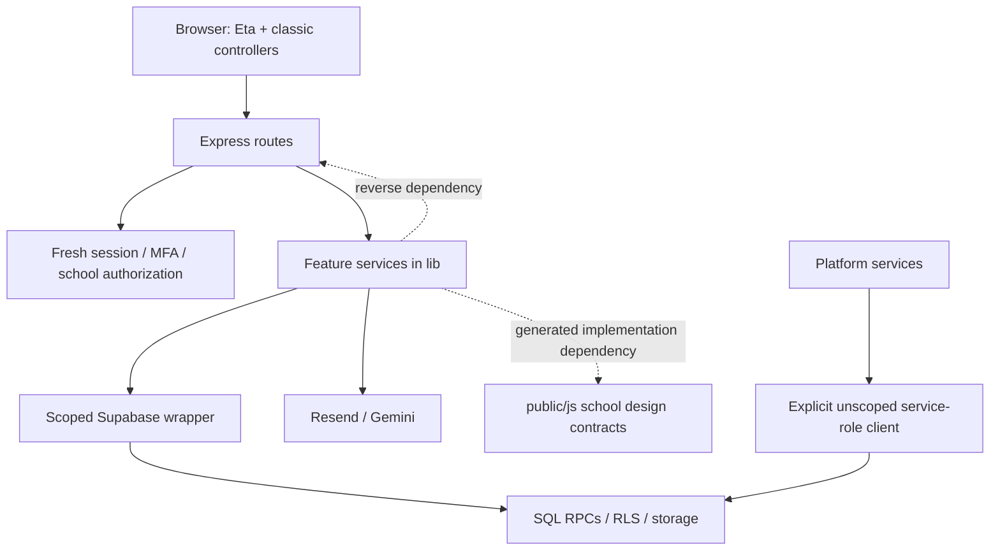

# SuggFeed code-health and production-readiness audit

Audit date: 26 October 2026. Baseline: `6da6fc938ad1b5539138ba717728ff372bc8a40d`.

**Scope:** read-only review of the current Express application, retained Supabase runtime, migrations, tooling and delivery configuration. Application source was not modified. Commands that generate files ran in an isolated copy under `audit/`. External application access was blocked and synthetic credentials substituted. No hosted data was exercised.

## 1. Executive summary

**Assessment: Level 2 — Tangled overall.** The staff work-board and visual-editor controllers contain localized Level 3 change risk. This is not a structureless application: routes, tenant authorization, SQL migrations and reusable services are recognizable. A full rewrite is not justified.

**Verdict: not ready for unconditional production sign-off. Refactor in place.** The release blockers are a known high-severity dependency advisory and a reproducibly failing regression baseline. Neither a successful build nor static tenant checks establish safe production behavior.

### Top five risks

1. **Known vulnerable request parser:** the npm deployment lock resolves body-parser 1.20.8, affected by GHSA-27r3-jxmh-p828. Public body parsing happens before request budgets.
2. **Unreliable regression gate:** 41 of 363 tests fail on both Node 22 and Node 24. Several failures are stale fixtures; these still prevent dependable verification of critical paths.
3. **Costly staff/editor changes:** `staff-tools.navigate` has cyclomatic estimate 82 and cognitive complexity 91; `school-studio-inspector.render` has 122 and 153 respectively. Shared browser state and weak DOM fixtures compound risk.
4. **Build-path disagreement:** pnpm and npm locks resolve different Supabase SDK versions; two server modules load generated browser output as their implementation.
5. **Incomplete operational evidence:** error diagnosis lacks correlation identifiers; general database waits have no common deadline; restore drills, branch protection and live compiled policies were not verified.

These are evidence-backed risks, not claims of a demonstrated account takeover, tenant data leak or data loss. No critical vulnerability was confirmed.

## 2. Architecture overview

### Discovery facts

- TypeScript Express application with server-rendered Eta; browser TypeScript compiles to classic scripts. No active React/Next/native app remains in this revision.
- Root pnpm 9.15.0 workspace delegates to `apps/web-express`; deployment/CI also use the app's standalone npm lock. Node 22 is the deployment target.
- Supabase JavaScript client provides database/auth/storage access. SQL functions, tenant ownership constraints and policy checks carry substantial business logic; no separate ORM.
- Browser integration: classic globals, DOM events, template data and generated assets. Server: route handlers, `src/lib` services and scoped database access.
- Integrations include Supabase, Resend email and Gemini assistance. Node test runner/ts-node tests, selective ESLint configurations, TypeScript builds, GitHub CI/security/deployment workflows.

```text
/
├── apps/web-express/
│   ├── api/index.ts          Vercel entry adapter
│   ├── src/server.ts         Express composition, security, sessions, routes
│   ├── src/routes/           HTTP handlers
│   ├── src/lib/              domain services, authorization, infrastructure
│   │   └── assistant/        bounded assistant feature
│   ├── src/client/           classic browser controllers; animations subsystem
│   ├── views/                Eta pages and partials
│   ├── public/               authored CSS/media plus generated JS/CSS/vendor assets
│   ├── tests/                Node tests, VM browser fixtures, preview utilities
│   └── scripts/              build and operational tooling
├── supabase/
│   ├── migrations/           76 forward schema migrations
│   ├── functions/            retained Deno entry points / retirement responses
│   └── templates/            auth email templates
├── scripts/                 root release/maintenance tooling
├── docs/                    guides and operational records
└── .github/workflows/        checks, security and deployment
```



The dashed edges are specific boundary problems, not a description of every service. Static graphs do not capture template/global/SQL edges completely.

## 3. Metrics summary

Full methods, per-module fan-in/out/instability, flagged functions and clone evidence: [metrics.md](metrics.md). Raw values: `raw/summary.json`, `raw/static-metrics.json`, `raw/cognitive.json`.

| Measurement | Fact |
|---|---:|
| Authored TypeScript modules / functions | 204 / 3,021 |
| Physical TypeScript lines | 15,511 |
| Functions cyclomatic estimate >20 | 82 |
| Sonar cognitive complexity >15 | 129 |
| Nesting >3 / functions >60 physical lines | 68 / 60 |
| Functions >5 parameters / files >300 lines | 5 / 14 |
| `any` nodes / casts or assertions | 399 / 1,018 |
| Empty catches / ts-ignore or nocheck | 40 / 0 |
| Classic browser scripts | 80 |
| Runtime static-import cycles | 1 two-module SCC |
| Duplication | 2.37% lines; 605 lines; 54 clone pairs |
| Target-runtime tests | 363 total; 321 pass; 41 fail; 1 skip |
| Instrumented-subset coverage | 70.45% lines, 73.15% branches, 68.44% functions |

**Interpretation:** casts are not automatically unsafe; empty catches include intentional browser-storage fallbacks. Compressed functions can be short yet extremely complex. Complexity estimates identify characterization priorities, not proof that a function cannot be tested. Duplication's denominator excludes Eta; much of the largest duplication is immutable migration history, which should remain unchanged.

Coverage includes 106 instrumented files and is **not whole-application coverage**. VM-executed browser controllers and unexecuted modules are not reliably represented. No flakiness rate can be inferred from two runs, although the same failure names reproduced.

| Check | Node 24 existing dependency tree | Node 22.23.4 clean pnpm tree |
|---|---|---|
| Type checking | pass, 12.83s | pass, 14.46s |
| Four scoped lint commands | all pass | not repeated separately |
| Tests | fail, 119.51s command | fail, 120.46s command |
| Production build | pass, 9.93s | pass, 10.86s |

Evidence: `raw/check-results.json`, `raw/node22/check-results.json`, `raw/test-outcomes.json`; logs retained. ESLint checks are selective, not full-codebase lint certification.

## 4. Hotspot ranking

Facts from local Git history in a 12-month window, current paths without rename-following. Available history is approximately August–October 2026. Ranking uses `changes × log2(max cyclomatic + 1)` as a transparent prioritization heuristic; it is not a standardized risk score. Evidence: `raw/static-summary.json`; line-level function evidence in metrics.

| Rank | Path under apps/web-express/src | Commits touching path | Max CC | Physical lines |
|---:|---|---:|---:|---:|
| 1 | server.ts | 33 | 15 | 374 |
| 2 | client/staff-tools.ts | 18 | 82 | 416 |
| 3 | routes/schools.ts | 24 | 24 | 352 |
| 4 | routes/api.ts | 18 | 51 | 388 |
| 5 | client/feed.ts | 15 | 34 | 447 |
| 6 | client/idea-detail-drawer.ts | 16 | 27 | 547 |
| 7 | routes/school-customization-preview.ts | 18 | 15 | 43 |
| 8 | client/staff-review.ts | 13 | 43 | 518 |
| 9 | client/school-customization.ts | 12 | 57 | 134 |
| 10 | routes/community.ts | 16 | 20 | 135 |
| 11 | client/community.ts | 15 | 24 | 170 |
| 12 | client/submit-panel.ts | 14 | 30 | 490 |

**Assessment:** server.ts is a normal composition root but warrants integration protection because it changes frequently. Staff controllers deserve extraction before another feature branch is appended. The inspector's exceptionally high cognition deserves attention despite lower historical churn. The report does not infer AI authorship from compressed or repeated code.

## 5. Structure and maintainability

### Module classifications — assessments supported by measured/source evidence

| Major area | Level | Reason |
|---|---|---|
| Server composition / routes | 2 Tangled | high churn; API handler CC51; school router authorization consumed from a library |
| Tenant/auth/session boundary | 1 Messy | discernible fail-closed boundary; dynamic service proxy and broad privileged client need disciplined callers |
| Staff work-board / progress UI | 3 Spaghetti locally | navigation CC82/cognitive91, progress composer cognitive76; shared DOM state and failing VM fixtures |
| Customization studio | 3 Spaghetti locally | inspector CC122/cognitive153/nesting14; generated implementation dependency |
| Student feed/detail/submission UI | 2 Tangled | several stateful long controllers, duplicated recovery/DOM assumptions; bounded feature organization still visible |
| Assistant | 2 Tangled | existing cohesive folder, but ask CC63 in 22 lines and action selection CC67 |
| Domain services / progress | 2 Tangled | services identifiable; one runtime cycle and mixed orchestration/evidence responsibilities |
| SQL migrations / tenant operations | 1 Messy | versioned constraints and restricted RPCs; long historical functions and deliberate repetition |
| Animation subsystem | 1 Messy | explicit configuration/lifecycle and lint boundary; browser behavior not re-certified here |
| Build / release tooling | 2 Tangled | two dependency installation paths, generated assets consumed at runtime, selective checks |

### File justification and discoverability

[File inventory](file-inventory.md) assesses 295 authored files before supplementary tool candidates: 266 keep, 22 split, 4 merge, 2 move, 1 candidate delete. Each has six criteria, purpose and destination. `?` means unverified, not permission to delete. Supplementary Knip candidates are catalogued separately in that artifact.

The main organizational problem is a broad `src/lib` and `src/client`, not excessive folder depth. Kebab-case naming is consistent. Feature UI, SQL, template and tests are distributed by technical layer; grep is needed to discover a complete behavior. `data.ts` handles submission data/cache responsibilities and merits a concrete split, whereas a global rename of all libraries has no measured benefit. No active apps cross-import one another; there is currently one active app and no shared package requiring a rewrite. No barrel-driven runtime cycle was established.

### Competing conventions and hidden edges

- `src/lib/school-customization-access.ts:3–11` imports `schoolAdmin` from a route. Authorization belongs below HTTP, not inside it.
- `src/lib/school-colors.ts:2` and `school-design.ts:6` require generated `public/js` files. The build order becomes a server-runtime dependency invisible to TypeScript's import graph.
- `progress.ts:3,19–20` and `progress-evidence.ts:5` form a runtime cycle through `ProgressError`. The school-scope/customization type-only cycle is reported separately in metrics; it is not a runtime cycle.
- `tsconfig.client.json:3–15` uses module:none and explicitly disables noImplicitAny/strictNullChecks, while the server is strict and selected browser cohorts receive stricter checks. Explicit DTO adapters should replace boundary `any` gradually.
- HTTP validation and database validation intentionally overlap; handwritten limits such as the board's 72-card window additionally occur in service, browser and two templates. Those protocol values should share a contract or server-supplied metadata.
- Server error types, catch-and-503 responses, console logging, browser error text and job logs differ. Existing purpose-built errors are worth keeping; add a common diagnostic envelope rather than a universal exception framework.
- Selective ESLint commands exist, but CI runs only animation lint. No full boundary/cycle regression gate currently protects the discovered edges.
- Tracked compiled assets are not safe deletion candidates today: runtime consumers and startup order depend on them. Remove them from tracking only after a clean-install/build bootstrap contract is proven.

Knip identifies 32 unused-file candidates and 19 modules with export/type candidates (`raw/knip.json`). Deno handlers, skill scripts and preview CLIs are executable entry points, so raw output is not a deletion list. `preloadPublicNavigation` is used locally through functions mounted in server.ts; an unused-export diagnostic does not make its implementation dead. `lib/auth-email-template.ts` has no in-repository caller; confirm external/manual tooling before removing it in favor of the existing Supabase templates.

## 6. Production Readiness Scorecard

Ratings are assessments of this revision and available evidence, not certifications of hosted configuration.

| Area | Rating | Evidence / principal gap |
|---|---|---|
| Security | Adequate, release blocker open | MFA, scoped queries, sessions/CSP/upload checks; high request-parser advisory remains |
| Reliability | Weak | receipts/idempotency and bounds exist; common DB deadlines and successful restore rehearsal unverified |
| Testing | Weak | 363 tests runnable, 41 fail, real concurrency test skipped; coverage denominator incomplete |
| Observability | Weak | safe-path logs and DB health exist; no correlation ID or demonstrated active error-tracking pipeline |
| Build/deployment | Weak | clean install/build succeed; divergent locks and red test gate; hosted protection/rollback not verified |
| Performance | Adequate | bounded board pagination, caches, optimized images; no live query plan, latency or mobile performance measurements |
| Accessibility / UX robustness | Adequate | semantic controls, focus/reduced-motion lifecycle code; full browser/device/contrast audit not performed |
| Documentation | Adequate | current README starts app, operational guides exist; ownership/boundary/contribution convention gaps |
| Data / migrations | Adequate | 76 versioned migrations and constraints; live compiled RLS and restore safety not certified |
| Dependency / supply chain | Weak | two advisories, divergent locks, unpinned release CLIs; license policy not enforced |

Security evidence: `server.ts:41–52,108–160,197–224`; `auth-assurance.ts:13–44`; `session-store.ts`; `supabase.ts:44–108`; `school-context.ts`; `school-images.ts:19–28`; `progress-evidence.ts:12–14`. Table-by-table lexical inventory: [rls-inventory.md](rls-inventory.md), 81 tables across 76 migrations. Dynamic SQL and policy replacement mean a source inventory cannot establish effective deployed RLS.

Deployment evidence: `.github/workflows/{ci,security,deploy}.yml`, `apps/web-express/vercel.json`, `docs/guided-workflows.md`. Deployment workflow confirms project/environment and gates migration/functions/Vercel work, but this does not prove actual GitHub/Vercel settings. `scripts/check-release.ts` intentionally refuses local production certification; its exit code is not itself a defect.

## 7. Findings by severity

**Critical:** none confirmed. Severity below is an assessment. Each entry separates observed evidence from its consequence.

### High

**H1 — Vulnerable public body-parser dependency** · security / dependency

- **Fact:** `raw/dependency-audit.json` identifies body-parser 1.20.8, affected `<1.20.9`, GHSA-27r3-jxmh-p828 (compressed-body denial of service). `server.ts:197–199` installs global body parsing before budget middleware at 207–224; 512 KB limits do not establish immunity to this advisory.
- **Risk:** attacker-controlled parsing could consume availability resources. No exploit was attempted.
- **Fix:** patch the dependency chain in the canonical lock, align both installation paths, inspect resolved versions, add bounded compressed-body regression checks before deployment.

**H2 — Critical-flow regression baseline is red** · testing / reliability

- **Fact:** both runtime trees reproduce the same 41 failing names; `raw/test-outcomes.json`, full logs. `comment-service.test.ts:20` omits the revision now required by `lib/comments.ts:20–22`. Feed mocks omit `document.querySelector`; staff DOM fixtures omit current lane/maximize controls.
- **Risk:** failures obscure new regressions. They are not 41 confirmed product bugs.
- **Fix:** repair fixtures against intended contracts, preserve negative authorization checks, add browser/DB characterization where VM mocks cannot represent behavior. Do not merely loosen assertions.

**H3 — High-complexity shared-state browser hotspots** · control-flow / state and data-flow / mixed concerns

- **Fact:** `client/staff-tools.ts:82–145` CC82/cognitive91, 18 changes; inspector `:14–59` CC122/cognitive153/nesting14; progress composer cognitive76. Metrics and Git ranking above.
- **Risk:** lane loading, selection, dragging, panel lifecycle and editor rendering interact in hard-to-isolate units.
- **Fix:** characterize refresh/cancel/stale-response/selection/focus first, then extract cohesive responsibilities locally. Preserve public DOM contracts and avoid simultaneous framework migration.

### Medium

**M1 — Divergent reproducible dependency paths** · configuration / operations

- **Fact:** root pnpm lock resolves Supabase JS 2.112.3; app npm lock resolves 2.117.2. Node types also differ (22.20.1/22.20.5). CI/deploy and local commands can select different trees.
- **Risk:** local passing behavior need not reproduce deployment.
- **Fix:** choose one supported install path, align locks while transition exists, fail CI on resolution drift. This is not evidence either SDK version is defective.

**M2 — Dependency direction and generated runtime contracts** · dependency / structure

- **Fact:** reverse route dependency and two generated-browser `require` calls listed in section 5; one runtime progress SCC.
- **Risk:** hidden initialization/build requirements and cycles increase safe-change cost.
- **Fix:** leaf authorization/error contracts and pure school-design/color contracts; adapters compile for each runtime. Keep moves and logic changes separate.

**M3 — Browser type/graph blind spots** · state and data-flow / testing

- **Fact:** module:none, relaxed client null/implicit-any flags, 80 scripts; 399 any nodes, 1,018 assertions across measured scope. Static imports omit global load-order edges.
- **Risk:** compile success cannot guarantee compatible runtime globals or DOM contracts.
- **Fix:** type adapters and strict checking per touched feature, document script ownership, add import/global-boundary checks as warnings first. Do not rewrite all clients at once.

**M4 — General DB work has no explicit common request deadline** · async / reliability

- **Fact:** readiness query `server.ts:249–255` and budget RPC `lib/read-budget.ts:32` lack explicit abort/deadline. Synthetic startup served account landing but `/health` exceeded a three-second client deadline with external access blocked (`raw/onboarding-start.json`). Assistant calls already have bounded orchestration; do not remove those controls.
- **Risk:** unavailable infrastructure can occupy request capacity or delay diagnosis. The synthetic result is not a live outage measurement.
- **Fix:** bounded request/DB operations with stable 503 codes, fail-closed permission checks, separate no-I/O liveness from DB readiness; test delayed/rejected providers.

**M5 — Failure diagnosis and recovery evidence incomplete** · operations / documentation

- **Fact:** `server.ts:333` central logging retains error name/method/path but lacks correlation identifier and stable cause code; `security-maintenance.ts:6–23` does provide structured bounded purge logging. No active Sentry SDK found in current app manifest/source. Restore guidance exists, no successful drill observed.
- **Risk:** user reports may be hard to connect to causes, and recovery time remains unknown.
- **Fix:** privacy-safe IDs/codes/timings; verify external monitoring with owner; run isolated backup/restore and deployment rollback drills. Never log comment bodies/tokens.

**M6 — Release guardrails cover only part of source conventions** · operations / testing / supply chain

- **Fact:** CI runs animation lint but not the other three passing scoped lint scripts. Deployment uses `supabase latest` and `npx vercel` (`deploy.yml:52,92`). Branch protection, staging and automatic Vercel deployment gates were not accessible for verification.
- **Risk:** newly failing checks or tool behavior can evade expected release controls.
- **Fix:** wire all existing checks, pin release CLI versions, document actual gates; verify hosted settings rather than infer them from YAML.

**M7 — Moderate transitive dependency advisory** · security / dependency

- **Fact:** npm audit identifies ip-address affected `<=10.7.3`, GHSA-rxp7-6hxx-x8q5, quadratic zone-identifier matching; fix available (`raw/dependency-audit.json`).
- **Risk:** exploitability through this app's actual call paths was not established.
- **Fix:** update/re-audit alongside H1 and trace relevant parsing callers if it remains installed.

### Low

**L1 — Scattered protocol constants** · configuration and magic values

- **Fact:** 72-card cap appears in `lib/staff-board.ts:42,52,86`, `client/staff-tools.ts:150–151`, two board templates.
- **Risk:** UI/server guidance can disagree during ordinary capacity changes.
- **Fix:** publish one validated server contract consumed by browser/template rendering; keep independent database safety bounds explicit.

**L2 — Candidate redundant auth template** · dead code / structure

- **Fact:** Knip flags `lib/auth-email-template.ts`; repository search found no caller; `supabase/templates/` contains checked templates.
- **Risk:** operators may edit the wrong copy. External usage is unknown.
- **Fix:** confirm ownership then remove or document the actual manual consumer. Do not delete all scanner candidates.

**L3 — Whole-code coverage / license evidence incomplete** · testing / supply chain

- **Fact:** c8 reports only instrumented subset; VM controllers lack full source attribution. Lock license metadata contains MIT, Apache, BSD, LGPL and mixed declarations; no automated license policy found. Outdated commands returned empty JSON, which is insufficient evidence of maintenance status.
- **Risk:** percentages can overstate confidence; legal obligations remain unreviewed. No license violation is asserted.
- **Fix:** publish a trustworthy coverage denominator and critical-flow matrix; have maintainers define license policy and verify direct dependency update cadence.

## 8. Change test and onboarding

These are real source traces, not implemented changes. Counts exclude generated artifacts, include the new migration when required and represent a minimum affected set, not a guarantee that implementation discovers nothing else.

| Proposed small change | Trace and minimum files | Verification / assessment |
|---|---|---|
| Board loaded-window 72 → 96 | `lib/staff-board.ts:42,52,86`, `client/staff-tools.ts:150–151`, `views/partials/staff-board-lane.eta:15`, `views/staff-board.eta:36`; two board tests. **4 source + 2 test files, 1 app** | Found by searching cap and lazy metadata. Tests exist but current paging/DOM fixtures fail. Medium: duplicated browser/server/window protocol, retained selections and per-stage links. |
| Increase permitted comment-report reason length only | `lib/comments.ts:22`, `routes/community.ts:23`, report markup in `views/idea.eta` (500 limit), new migration replacing current `comment_action` report validation (`202610250003…:136`); `comment-service` and `comment-moderation-db` tests. **At least 4 source/migration + 2 test files, 1 app + database** | Search reason/textField/500 then follow RPC action. Must distinguish comment body, report reason and admin explanation limits, which currently share numbers. Medium: change DB and HTTP validation atomically without widening unrelated inputs. |
| Add build identifier to health JSON | `src/server.ts:249–255`, new health response test. **1 source + 1 test, 1 app** | Found route via health/readiness search. No dedicated health-route test found in present tests. Low: additive response, keep 503 behavior and never expose env/secrets. Demonstrates a genuinely bounded change. |

### README-only onboarding performed

1. Followed root README to the active Express app; no need to restore retired Next/mobile apps.
2. Frozen pnpm install in an isolated tree succeeded in 6.01s (`raw/install-result.json`). Temporary installation/tool cache stayed inside audit.
3. Type checking and production build passed on target Node 22.23.4. Full tests reproduced 321 pass/41 fail/1 skip.
4. Started built server with synthetic nonproduction credentials and network guard. `/account/home` redirected to `/schools` and final response was 200 (`raw/start.log`, `raw/onboarding-start.json`). Authenticated and live-database flows deliberately not exercised.
5. `/health` waited beyond three seconds under blocked infrastructure. No readiness success claimed. Process shut down cleanly on SIGTERM.
6. Discovered two lockfile resolution paths while following root versus app commands. Finding M1 records the guess a newcomer must otherwise make.
7. Located the three changes above with ripgrep, then followed templates/RPCs/tests. Board cross-layer constants and report-vs-comment length reuse are concrete discovery costs.

The assignment concurrency test is explicitly skipped without `ASSIGNMENT_TEST_CONTAINER` (`tests/assignment-concurrency.test.ts:11`); Node tests do not substitute for that database race test. No staging accounts or production writes were needed for this audit.

## 9. Positive findings to preserve

- Production startup rejects missing Supabase configuration and weak/missing session secret (`server.ts:41–52`).
- Helmet/CSP, secure production cookies, encrypted/hash-keyed session storage and verified MFA are real server controls, not visual gates.
- Fresh school membership/policy/roster checks and scoped database wrapper fail closed. Explicit platform service-role use is a boundary to review, not proof of a leak.
- Health checks actually query the database; expired-session cleanup is implemented and bounded (`security-maintenance.ts:6–23`).
- Submission receipts, version conflicts, bounded board paging and restricted RPCs demonstrate deliberate retry/concurrency design.
- Raster validation/re-encoding, pixel/time limits and private evidence rules are substantial upload protections.
- Assistant budgets, grounded sources, deadline/circuit orchestration and lease release already exist (`assistant/service.ts:15–36`).
- Low measured duplication does not justify a sweeping shared-library extraction. Immutable migrations should remain intact.
- Source and history secret scans found zero findings outside existing gitleaks exclusions (`raw/secret-findings-paths.json`). This does not certify ignored, untracked, hosted or previously excluded material.
- Clean installation, type checks, four scoped lints and builds are reproducible; retain these while repairing verification.

## 10. Minimal target architecture

Retain Express/Eta, classic-script delivery during transition, existing SQL authority and one active app. No new shared package is warranted today.

```text
apps/web-express/
├── src/server.ts                  composition only
├── src/routes/                    thin HTTP validation/response adapters
├── src/features/
│   ├── submissions/               creation/query/cache use cases
│   ├── progress/                  service, evidence, leaf error contracts
│   ├── schools/                   authorization and studio-access policy
│   └── notifications/             bounded digest delivery
├── src/lib/                       existing cohesive services; migrate only touched hotspots
│   └── assistant/                 existing assistant feature, retain public API
├── src/contracts/                 pure school color/design rules for two runtimes
├── src/infrastructure/            scoped database and external adapters
├── src/client/
│   ├── work-board/                loading, selection, drag, review/progress adapters
│   ├── studio/                    controller and theme/form/layout inspectors
│   └── animations/                existing reusable lifecycle/config
├── views/                         server templates with explicit data contracts
├── tests/                         public use-case and browser integration characterization
└── public/                        authored CSS/media; reproducibly generated delivery output
supabase/                          migration authority, restricted RPCs, storage/auth templates
scripts/                           release/maintenance entry points
 docs/                             architecture, decisions, environment, runbooks, contribution
```

**Why these boundaries:** work-board modules separate the states mixed in H3; studio inspectors divide the 153-cognition renderer; leaf progress contracts remove a measured cycle; school authorization removes the reverse route import; pure contracts remove two generated-runtime dependencies. Infrastructure is a home for existing privileged/scoped clients, not an extra repository class per table. Keep ordinary cohesive services where they are until a real change needs them.

### Rules and conventions

- Routes depend on feature services; services depend on contracts/infrastructure; contracts depend on neither routes nor browser delivery. Browser code cannot import server credentials/adapters.
- Only named platform administration entry points may use the unscoped client; school operations use the scoped wrapper and SQL authority.
- Add boundary/cycle checks in warning mode with the current baseline, then enforce no new violations before reducing existing debt.
- Kebab-case files/folders; types beside their owner, shared contracts only for demonstrated cross-runtime use. Explicit exports; no blanket barrels.
- Tests stay discoverable under the current tests directory with feature prefixes; local extraction tests may be colocated if tooling explicitly includes them. Avoid a wholesale test relocation.
- Configuration has typed, bounded validation; browser gets an allowlisted projection. Secret values never cross that boundary.
- Soft limits: approximately 300 lines/file, 60/function, cognitive15; exceptions justified by cohesive flat data or orchestration. Warn first; complexity is not a reason to create dozens of single-use wrappers.
- One purpose per new file; no generic utils/common dump, commented-out historical implementation or backup files.
- Generated files cease being committed only after isolated clean-build/start parity and removal of generated-runtime dependencies. Until then preserve required delivery files.
- Shared packages require at least two independent consumers and an owner. There is no second active application today.

Every non-keep inventory row has a target mapping. Proposed merges of repeated local controller snippets are behavior-reviewed local extractions, not automatic unification based on text similarity. New paths are a map for incremental work, not a request to move the entire tree in one commit.

## 11. Refactor and migration plan

Durations are planning estimates, not measured delivery promises. Each phase starts with characterization. **For moves:** commit a pure `git mv`/rename preserving contents, then a separate import-update step, then checks; logic changes follow separately. If the intermediate rename commit is not buildable, group those commits into one reviewable PR without mixing semantic changes into them.

| Phase | Goal / files | Tests required before changes | Risk | Done check |
|---|---|---|---|---|
| 0 · 1–2 days | Repair regression contracts; patch H1/M7 locks | failing comment revision, feed DOM, platform roles, board lifecycle assertions; bounded parser cases | medium | clean target-runtime suite; both advisories removed/reassessed with proof |
| 1 · 1–2 days | Canonical dependency/build path; package/workflow/README updates | frozen install and built-start smoke from empty output; resolution equality | low–medium | one documented install path, reproducible artifact, every scoped lint wired; hosted release gate confirmed |
| 2 · 1–2 days | Remove progress cycle and reverse school authorization dependency | MFA/tenant/grant denial, evidence errors and existing progress receipts | medium | no new/runtime SCC; no lib→routes import; unchanged public contracts |
| 3 · 2–3 days | Extract work-board loading/selection from staff-tools, then progress/review ownership | stale responses, lazy windows, selected group drag, close/reopen/focus, partial failures, exact IDs | medium–high | current interactions preserved in real DOM checks; targeted cognition reduced; no new global state |
| 4 · 2–3 days | Studio inspector sections and pure design/color contracts | saved/current values, inline editing, preview no-action, CSS/theme parity, draft conflict/restoration | medium–high | server no longer requires public/js; clean-build boot works; published student behavior unchanged |
| 5 · 1–2 days | DB deadlines, safe error IDs and operations docs/drills | timed-out provider, readiness 503, session outage, receipt retry after ambiguity | medium | bounded requests, report traceable without content logs; isolated restore/rollback evidence recorded |

### Quick wins under half a day each

1. Prepare the body-parser chain patch and resolution check; release only after focused/full verification.
2. Repair the missing comment revision test input and shared DOM fixture capabilities, keeping assertions for current security contracts.
3. Wire the three existing extra scoped lint commands into CI and publish lock-resolution comparison; begin cycle/boundary warnings.

### Documentation deliverables

- README: one supported Node/install/build/start path and expected no-live-DB limitations.
- Architecture page: current tenant authority, classic-script globals, server/browser contracts and allowed dependency directions.
- Environment reference: variable names, purpose, validation, scope and rotation procedure, never real values.
- Decision records: one active web app; generated-contract transition; canonical lock path; service-role ownership.
- Runbook: health/readiness errors, safe tracing, database/session/provider incidents, rollback/restore with measured drill evidence.
- Contribution guide: characterization-first, separate moves/logic, inventory purpose requirement, local/CI commands and ownership.

### Definition of done for production

- [ ] Known high advisory patched; remaining dependencies explicitly triaged.
- [ ] Target-runtime type, scoped lint, build and tests green from canonical clean install.
- [ ] Critical auth/MFA/tenant/report/vote/submission/staff flows exercised in isolated browser and database fixtures.
- [ ] Assignment race/capacity test runs against disposable PostgreSQL; no hidden required skips.
- [ ] Effective deployed roles/RLS/RPC grants reviewed against the 81-table inventory.
- [ ] Deadlines/error IDs and monitored failure alerts demonstrated without sensitive logging.
- [ ] Branch/deployment protection and environment validation confirmed in hosted configuration.
- [ ] Backup restore and application rollback rehearsed with recovery evidence.
- [ ] Mobile/keyboard/reduced-motion and resource budget checks performed for touched controllers.
- [ ] Documentation and owners updated; source/bundle/lock consistency verified.

## 12. Open questions

1. Which lock/install path should become authoritative: root pnpm or standalone npm deployment? Can deployment change to the chosen path?
2. Are the current failing UI assertions describing intended old behavior or obsolete markup? Product owners must resolve genuinely conflicting expectations before tests are rewritten.
3. Who owns school/SQL authorization and release approval? What branch protection, Vercel auto-deploy and external alerting are actually enabled?
4. Can a disposable database be allocated for migration replay, race tests and restore rehearsal? This audit intentionally avoided hosted data.
5. What are the required recovery time, acceptable error latency and traffic envelope? No latency SLO or tested restore duration was established.
6. Does any external/manual process consume `auth-email-template.ts` or generated contract files outside documented builds?

No additional permission is needed to review these artifacts. Resolve questions 1–4 before beginning the corresponding refactor/release work.

## 13. Limitations and evidence boundaries

- Static/sample review is not a proof of all protected paths, effective RLS, compiled grants, browser escaping or absence of secrets. Source RLS inventory is lexical; dynamic migration behavior requires a database copy.
- Existing gitleaks ignore rules apply. Outputs retain only paths/types and no secret values. No real environment files/credentials were copied into test runs.
- No hosted production writes, authenticated production flow, penetration test, load test, Lighthouse run, physical device test, live EXPLAIN/index measurement or recovery drill occurred.
- Tests were run with synthetic credentials/network isolation. Clean install and Node22 repeat distinguish consistent fixture failures from one host's dependency tree; some integration failures still require their intended database environment.
- ESLint is scoped; cognitive scoring uses the actual standalone Sonar rule after full-plugin initialization failed. CC/nesting are custom AST estimates with documented denominator. Dynamic imports, require, SQL and globals need manual graph review.
- jscpd omits Eta and generated files; Knip candidates need ownership review. Empty outdated output is not an assurance about upstream maintenance. License declarations are metadata, not legal advice.
- Coverage excludes reliable whole-source/VM attribution. One concurrency test skipped. Same failures on two runs establish reproducibility, not a flakiness probability.
- Raw source copies, temporary dependency caches and V8 blobs are removed after metrics collection; scripts, measured summaries, logs and coverage reports remain in audit. Re-run tools against the pinned revision for replication.
- Audit made no application/source changes and no commit. Final worktree check is recorded in `raw/final-status.json`.
